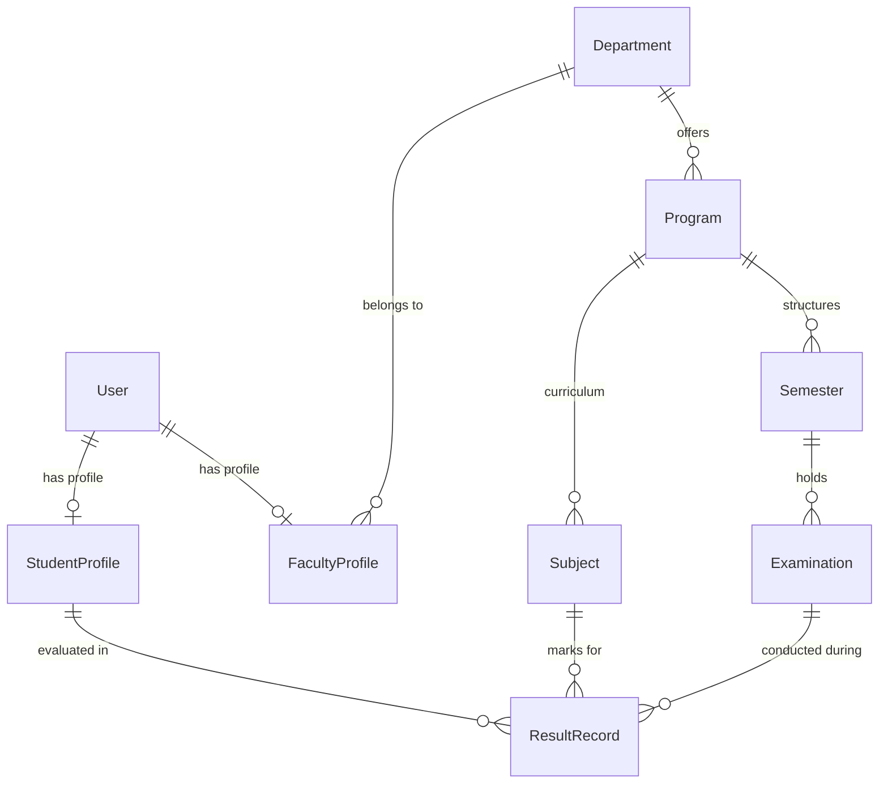

# CEHP Database Schema & Data Models

Database Engine: **MongoDB (via Mongoose ODM)**

---

## 1. Schema Hierarchy & Relationships

---

## 2. Core Collections

### 1. `users`
- `email` (String, unique, indexed, lowercase)
- `passwordHash` (String)
- `role` (Enum: `ADMIN`, `EXAM_OFFICER`, `HOD`, `FACULTY`, `STUDENT`)
- `accountStatus` (Enum: `ACTIVE`, `SUSPENDED`, `LOCKED`)
- `loginAttempts` (Number, default 0)
- `lockUntil` (Date)
- `refreshTokenHash` (String)
- `timestamps` (`createdAt`, `updatedAt`)

### 2. `student_profiles`
- `userId` (ObjectId -> `users`, unique index)
- `registerNumber` (String, unique, indexed)
- `departmentId` (ObjectId -> `departments`)
- `programId` (ObjectId -> `programs`)
- `admissionYear` (Number)
- `currentSemester` (Number)
- `cgpa` (Number, default 0.0)
- `totalCreditsEarned` (Number, default 0)

### 3. `faculty_profiles`
- `userId` (ObjectId -> `users`, unique index)
- `employeeId` (String, unique)
- `departmentId` (ObjectId -> `departments`)
- `designation` (String)
- `assignedSubjectIds` ([ObjectId -> `subjects`])

### 4. `subjects`
- `code` (String, unique, indexed)
- `name` (String)
- `credits` (Number, range 1-10)
- `type` (Enum: `THEORY`, `PRACTICAL`, `PROJECT`, `ELECTIVE`)
- `internalMaxMarks` (Number, default 40)
- `externalMaxMarks` (Number, default 60)
- `totalMaxMarks` (Number, default 100)

### 5. `result_records`
- `studentId` (ObjectId -> `users`, indexed)
- `subjectId` (ObjectId -> `subjects`, indexed)
- `semesterId` (ObjectId -> `semesters`, indexed)
- `examinationId` (ObjectId -> `examinations`, indexed)
- `internalMarks` (Number, range 0-40)
- `externalMarks` (Number, range 0-60)
- `totalMarks` (Number, range 0-100)
- `grade` (String: `O`, `A+`, `A`, `B+`, `B`, `C`, `P`, `F`, `AB`)
- `gradePoint` (Number, range 0-10)
- `status` (Enum: `DRAFT`, `SUBMITTED`, `APPROVED`, `PUBLISHED`)
- `attemptNumber` (Number, default 1)
- `isArrear` (Boolean, default false)
- **Compound Unique Index**: `{ studentId: 1, subjectId: 1, examinationId: 1, attemptNumber: 1 }`

### 6. `audit_logs`
- `actorId` (ObjectId -> `users`)
- `action` (String: `MARKS_ENTRY`, `SUBMIT_MARKS`, `APPROVE_MARKS`, `PUBLISH_EXAMINATION`, `LOGIN_FAILED`)
- `targetEntity` (String)
- `targetId` (ObjectId)
- `ipAddress` (String)
- `timestamp` (Date, indexed)
